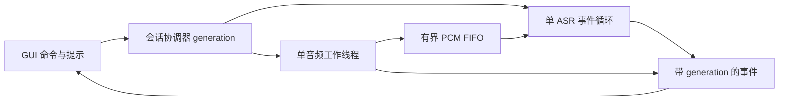

---
name: voice-input-startup
type: architecture-spine
purpose: build-substrate
altitude: feature
paradigm: session-scoped actors with bounded producer-consumer FIFO
scope: 双 Ctrl 语音输入的本地就绪、并行建连、停止与清理
status: final
created: '2026-11-10'
updated: '2026-11-10'
binds: [speech_input, realtime_asr, voice_ui]
sources: ['D:/code/sj/.diagnostics/voice-slow-20261109/report.md']
companions: ['../plan-voice-input-startup-20261110.md']
---

# 语音启动一致性约定

## Design Paradigm

每次录音是独立代次的会话；GUI 发命令，音频工作线程生产 PCM，ASR 事件循环消费同一有界 FIFO。已有运行依赖保持，部署与日常进程管理不属于本次计划执行。

## Invariants & Rules

### AD-1 — 独立会话与单一资源所有者

- **Binds:** speech_input, realtime_asr, voice_ui
- **Prevents:** 旧连接、回调、清理操作更改新录音或已销毁窗口。
- **Rule:** 代次绑定 stream、client、FIFO、任务与结果；设备仅音频工作线程打开/启动/停止/关闭，网络对象仅 ASR loop 使用。GUI 不等待 Future、设备 I/O 或线程 join；锁中不做 I/O、不触发外部回调。每个迟到任务只清理自己捕获的会话资源。GUI 投递事件执行时再次检查代次、closed 和事件是否仍有效；每会话最多接纳一次结果或失败。成功提交必须在设备已停、FIFO sealed且排空、终包已成功发送、收到协议final、失败/取消标记均未设置时原子裁决。FIFO满等失败立即在FIFO锁下标记，不能只投递异步错误事件；需同时持锁时固定协调器锁→FIFO锁，回调不反向取协调器锁。

### AD-2 — 本地可采音才提示 [ADOPTED]

- **Binds:** speech_input, voice_ui
- **Prevents:** 提前提示却没录到句首，或仍然等待云端连接才提示。
- **Rule:** stream.start 成功且首个有效 PCM 回调已入 FIFO 后，才发出该代次一次 ready 音效事件；网络建立并行进行，不作为 ready 条件。停止或取消已被接纳的会话不得再发 ready。首帧成功不包含音频设备 overflow 等无效状态。

### AD-3 — 一个有界 FIFO，连接前后同序

- **Binds:** speech_input, realtime_asr
- **Prevents:** start 重置队列丢句首、连接后新帧插队、事件循环待执行回调无限增长。
- **Rule:** 16kHz/单声道/int16，FIFO 最大 640000 PCM 字节（20秒）；200ms 帧为6400字节，另最多一帧发送中。FIFO 在本会话采音前创建，ASR start 不重建它。预连接和实时帧走同一FIFO且只有一个sender；跨线程唤醒合并，最多一个待处理通知。超限、输入溢出或发送失败使整个会话失败且不插入部分识别结果，禁止丢最旧/最新帧后继续假成功。

### AD-4 — stop、cancel 与 close 各有语义

- **Binds:** speech_input, realtime_asr, voice_ui
- **Prevents:** 句尾丢失、两次终包、取消后插字、退出卡死。
- **Rule:** stop 接纳后立即请求设备停止，设备停稳/回调静默后 seal FIFO；连接未就绪则在原建连deadline内等待，按序排空后只发一个负序号终包。cancel 立即使该代次失效、丢缓存、取消建连/收发、后台清理，不发转写结果；close 另永久关闭控制器并在后台回收 loop/音频线程。所有清理幂等、有界，取消不得走正常finish等待最终结果。

### AD-5 — deadline 与终态明确

- **Binds:** speech_input, realtime_asr
- **Prevents:** Future超时后任务仍活跃、错误被误称麦克风失败、重复错误提示。
- **Rule:** 建连含初始请求从启动请求起10秒，首帧从设备start返回起2秒；已连接且FIFO已seal后，排空及终包发送总预算12秒；最终结果从终包成功发送起12秒；网络清理总预算3秒。使用单调时钟且不因stop重置建连预算。超时取消对应任务并finally关闭部分资源。设备错误、网络错误、缓存满、最终结果超时分别可辨识；正常final或异常EOF均终结sender/receiver，不依赖仅_running布尔值决定能否清理。

## Stack

本地源码环境于2026-11-10读取已安装metadata；保持已有依赖，不声称为最新版本，也不据此升级生产依赖。

| Name | Version |
| --- | --- |
| aiohttp | 3.14.3 |
| sounddevice | 0.5.5 |
| wxPython | 4.2.5 |

## Deferred

- 连接预热、复用、重连：与本地即时开始无必要依赖；本次不引入。
- 数小时后变慢的DNS/TCP/TLS内部归因：原现场未分解，本次方案解除其对采音提示的阻塞，不宣称解释历史机制。
- 部署/重包/重启：本次仅计划，后续另按仓库既有交付规则操作。
- 音频驱动无法返回的原生调用：Python线程无法安全强杀；不得再并发打开第二个设备，保持不可用并提示，后续单独评估音频进程隔离。

